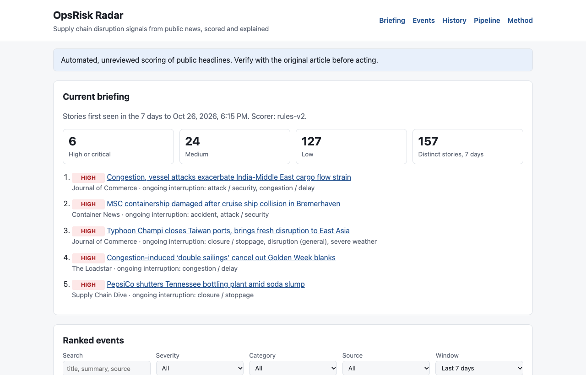
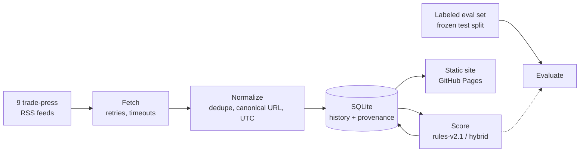
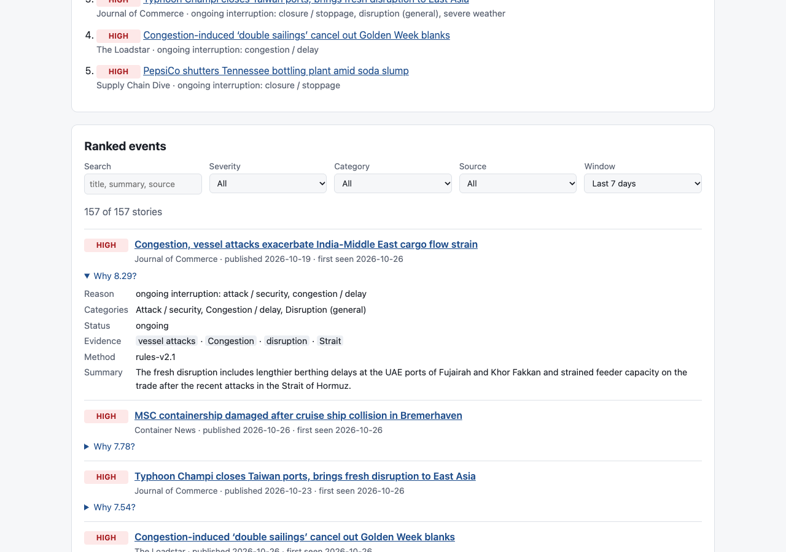

# OpsRisk Radar

[](https://github.com/Qiao527/opsrisk-radar/actions/workflows/ci.yml)
[](https://github.com/Qiao527/opsrisk-radar/actions/workflows/pipeline.yml)


**Supply chain disruption monitoring from public news: ingest trade-press RSS
feeds, find the articles that report an actual interruption to goods,
capacity or production, rank them, and explain every score.**

**Live dashboard:** https://qiao527.github.io/opsrisk-radar/ (updated daily
by the scheduled pipeline; first published 2026-10-26)



## The problem

An operations team at a manufacturer or shipper sees 150+ trade-press
headlines a day. Most are earnings, deals, product launches and opinion. A few
report something that stops goods moving: a port closed by a typhoon, tankers
attacked in a strait, a vessel detained after a collision, a tariff change
with an effective date. The useful question is *which of today's stories
report an interruption, and why should I believe that?*

OpsRisk Radar answers it with a ranked, explained list, published as a static
site that anyone can open without installing anything.

## Status

| Capability | State |
|------------|-------|
| Ingestion, storage, scoring, dashboard build | **Implemented and tested** (145 tests; live smoke runs on 2026-10-26) |
| Scheduled pipeline and Pages deployment | **Live.** First production run 2026-10-26: 9/9 feeds, 150 articles, all validation checks passed, deployed to Pages |
| Rule-based scorer rules-v2.1 | **Default.** Evaluated only against machine-suggested labels |
| LLM and hybrid scorers | **Implemented and tested with mocks; not run against the live API** (no key configured) |
| Human-labeled evaluation | **Pending**: 0 / 100 rows labeled |

## How it works



1. **Ingest.** Feeds are fetched concurrently with timeouts and retries
   (timeouts, 429, 5xx; `Retry-After` honored). Each feed's outcome is
   recorded, and a run fails loudly if fewer than half the feeds succeed.
2. **Normalize and store.** Entities and WordPress boilerplate are stripped,
   URLs canonicalized (tracking parameters, `www`, trailing slashes), times
   converted to UTC. A story first seen keeps its first-seen time; near-identical
   headlines from other sources are linked as duplicates. Schema changes are
   versioned migrations. Every run records version, git commit, config hash and
   per-feed results.
3. **Score.** The default scorer classifies the **event** (closure, strike,
   attack, accident, outage, severe weather, congestion, dated trade measure),
   its **status** (ongoing, resolved, speculative) and the **article type**
   (earnings, deal, opinion...), then maps the class to a severity band. Every
   score stores the matched evidence and a reason. An optional hybrid sends
   the ~29% of articles that are not clear noise to Claude, which must quote
   the article verbatim; any failure falls back to the rule score.
4. **Publish.** The dashboard is rebuilt from the full history each day:
   briefing, ranked events with filters and search, 30 days of daily
   snapshots, weekly summaries, pipeline status, and the method. Stale or
   non-live data is labeled on the page.



Details: [architecture](docs/architecture.md) ·
[scoring methodology](docs/methodology.md) ·
[evaluation](docs/evaluation.md) ·
[labeling guide](docs/labeling_guide.md) ·
[automation](docs/automation.md)

## Engineering highlights

- **Diagnosed a structural calibration bug instead of moving thresholds.** The
  original scorer averaged five keyword dimensions, so a pure disruption could
  score at most 5.05 and never reach HIGH; on 150 live articles all were LOW
  and "port operator *strikes* deal" outranked "typhoon closes Taiwan ports".
  The replacement scores the event and its status.
- **Evaluation built to resist self-deception.** Written operational labeling
  guide; temporal dev/test split frozen before the new scorers existed, with a
  content fingerprint and a logged record of every test-set look; tie-aware
  ranking metrics (verified against brute-force enumeration) with bootstrap
  intervals; a source-only baseline to detect source leakage; machine-suggested
  labels kept separate from human labels and stamped "provisional" on every
  report.
- **LLM output treated as untrusted input.** Structured outputs, verbatim
  evidence checks with downgrade on unsupported claims, severity-band
  consistency, caching by model and prompt version, per-run call budget, cost
  tracking, and a rule-based fallback.
- **Operable in production.** Idempotent incremental runs, transactional
  ingest, persistent history across scheduled runs (release-asset storage with
  rollback copy), explicit failure exit codes, failure issues, schedule
  keepalive, staleness shown to readers.

## Results so far

On the frozen 58-article test split, against **machine-suggested** labels
(not human judgments; same model that wrote the rules; read the test articles
while labeling):

| | rules-v1 | rules-v2.1 | random order |
|---|---:|---:|---:|
| nDCG@10 | 0.57 | 0.99 | 0.24 |
| Recall@10, act | 0.50 | 1.00 | 0.17 |
| Act articles rated HIGH+ | 0 / 4 | 4 / 4 | — |
| Non-act articles rated HIGH+ | 0 | 2 | — |

These numbers show the calibration defect is fixed; they are **not** an
accuracy claim. See [docs/evaluation.md](docs/evaluation.md) for the
false-positive analysis and what remains before results are citable.

## Run it locally

```bash
git clone https://github.com/Qiao527/opsrisk-radar.git && cd opsrisk-radar
python3 -m venv .venv && source .venv/bin/activate
pip install -e ".[dev]"            # add ,llm for the optional LLM scorer

python -m opsrisk run              # fetch → score → daily brief
python -m opsrisk validate         # data quality checks
python -m opsrisk site --out site  # build and check the dashboard
python -m http.server -d site      # open http://localhost:8000
```

| Command | Purpose |
|---------|---------|
| `run` / `fetch` / `score` | Pipeline, or one stage |
| `status` | Recent runs with feed success and commit |
| `validate` | Data quality checks (exit 1 on failure) |
| `site` | Build and validate the static dashboard |
| `evaluate` | Compare scorers on the labeled set (`--split test --final` for the frozen split) |
| `agreement` | Cohen's κ between label sources |
| `brief`, `weekly`, `html`, `source-audit` | Markdown, HTML and email reports; per-source metrics |

Global options: `--db`, `--config`, `--log-format json`, `--min-ok-feeds`.

## Tests and quality

```bash
pytest                 # 145 tests, no network
ruff check src tests scripts
```

Covered: RSS parsing and malformed feeds, retries and network failures,
migrations, idempotency and rollback, deduplication, scorer specifications
per labeling-guide rule, LLM validation/caching/fallback with a fake client,
metric correctness under ties, evaluation guards (test-split access,
fingerprint, labeler requirement), CLI end to end on a fixture feed, report
snapshots, and dashboard build validation. CI runs on Python 3.11–3.13, builds
and installs the wheel in a clean environment, and runs `pip-audit` and
`bandit`.

## Limitations

- Headlines and summaries only; scores describe what an article says, not
  verified facts.
- Known rule failure modes: strategic plant closures and event-driven analysis
  pieces can score HIGH; interruptions mentioned only in a summary stay MEDIUM.
- 9 enabled English-language trade feeds. Spend Matters is disabled because
  its feed URL now redirects to an HTML page; Interact Analysis was disabled
  earlier as mostly market research.
- Evaluation set: 100 articles from one fetch, 6 suggested act cases; human
  labels pending.
- The schedule keepalive is a mitigation for GitHub's 60-day inactivity
  disable, not a guarantee; the page's stale banner is the backstop.

## Project layout

```
src/opsrisk/       pipeline, scoring, evaluation, reporting, site builder
src/opsrisk/assets/site/   dashboard (HTML, CSS, vanilla JS)
config/sources.toml        feeds, scorer, LLM settings
eval/              labels, machine suggestions, frozen split, test-access log
docs/              architecture, methodology, evaluation, labeling guide, automation
tests/             pytest suite, fixture feed, report snapshots
```

## License

MIT
