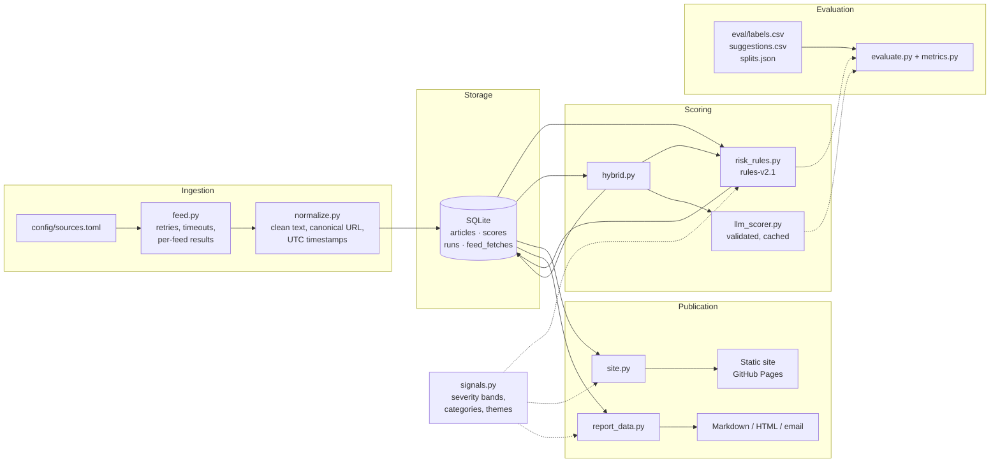

# Architecture

OpsRisk Radar is a batch pipeline: fetch RSS feeds, normalize and store
articles in SQLite, score them, and publish a static dashboard. One scheduled
GitHub Actions workflow runs it daily; there is no server.

## Modules

| Layer | Module | Responsibility |
|-------|--------|----------------|
| Config | `config.py` | Feeds, scorer selection, LLM model and call budget |
| Ingestion | `feed.py` | Concurrent fetch (bounded), retries on timeouts/429/5xx with backoff and `Retry-After`, a `FeedResult` per feed |
| | `normalize.py` | Entity decoding, feed boilerplate removal, canonical URLs, title tokens for near-duplicate detection, UTC conversion |
| Storage | `database.py` | Versioned migrations, transactional batch ingest, deduplication, run provenance, report queries |
| Orchestration | `pipeline.py` | `fetch` and `score` steps, failure threshold, git SHA and config hash |
| Scoring | `scorer.py` | rules-v1 keyword dimensions (kept as supporting signals and for comparison) |
| | `risk_rules.py` | rules-v2.1: event, status and article-type classification with evidence |
| | `llm_scorer.py`, `hybrid.py` | LLM assessment and the cost-aware hybrid |
| Shared rules | `signals.py` | Severity bands, category labels, themes, market-forecast patterns |
| Evaluation | `evaluate.py`, `metrics.py`, `scorers.py` | Datasets, frozen split, tie-aware metrics, scorer registry |
| Reporting | `report_data.py`, `brief.py`, `weekly.py`, `html_report.py`, `email_digest.py` | Markdown, HTML and email outputs |
| Publication | `site.py`, `assets/site/` | Static dashboard data export and validation |
| Quality | `validate.py`, `source_audit.py` | Data quality checks and per-source metrics |
| Interface | `__main__.py`, `log.py` | CLI and text/JSON logging |

## Data model

All timestamps are naive ISO-8601 strings in UTC, so they compare correctly
as text.

- **articles**: one row per canonical URL. `fetched_at` is when the story
  was first seen and is never rewritten; `last_seen_at` moves on every fetch.
  `content_hash` changes when the title or summary changes, which queues a
  rescore. `duplicate_of` links a near-identical headline (title-token
  Jaccard ≥ 0.8 within 7 days) to the first report of the story.
  `first_run_id` records which run inserted it.
- **scores**: one current score per article, with the `scorer` id that
  produced it (including the rule-set version), the article `content_hash` it
  was computed from, and a JSON `detail` holding evidence and reasons.
- **runs** and **feed_fetches**: every `run` records the package version, git
  commit, config hash, scorer, outcome and per-feed HTTP status, entry count,
  attempts and duration.

Schema changes are numbered migrations tracked in `PRAGMA user_version`. The
v1→v2 migration canonicalizes stored URLs (merging tracking-URL copies) and
converts offset timestamps to UTC.

## Incremental and idempotent runs

- Ingest is one transaction: a crash stores nothing rather than half a batch.
- Re-fetching an unchanged article updates only `last_seen_at`.
- An article is rescored only if it is new, its text changed, or the stored
  scorer id differs from the configured one. Running twice in a row inserts and
  rescores nothing.
- The dashboard is rebuilt from the whole database on every run, so daily and
  weekly views always come from the same history.

## Failure behavior

| Failure | Behavior |
|---------|----------|
| One feed times out or returns 5xx | Retried up to 3 times; then recorded as failed, other feeds continue |
| Feed returns HTML or malformed XML | Recorded as `malformed`/`empty`; run status becomes `partial` |
| Fewer than 50% of feeds succeed | `run` exits 2, the run is recorded as `failed`, nothing is published |
| LLM unavailable, refused, malformed or over budget | Rule score is kept and recorded as `rules-v2.1`, so it is retried later |
| Saved database cannot be downloaded in CI | The workflow fails instead of starting an empty history |
| Data validation or site check fails | The workflow fails before upload; the previous site stays live |
| Pipeline stops running | The dashboard shows a stale-data banner from its own timestamps |
